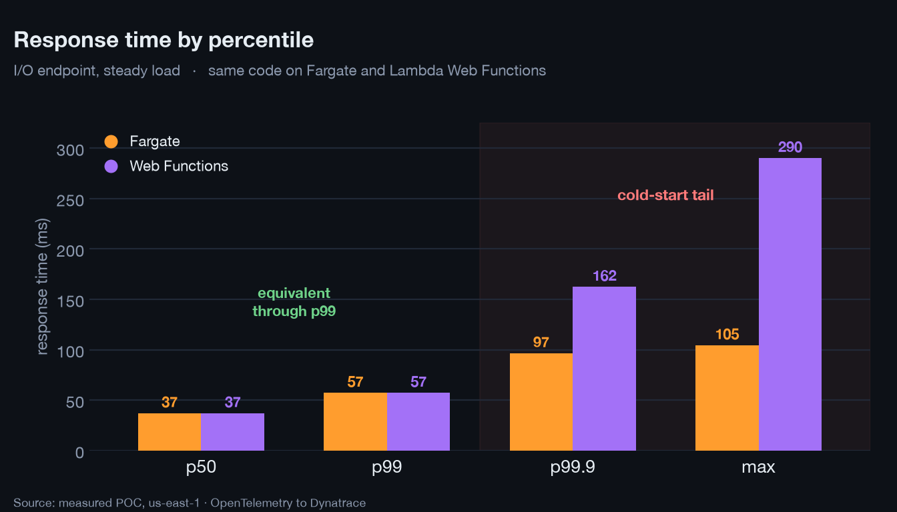
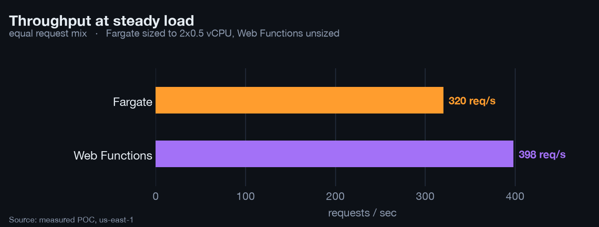
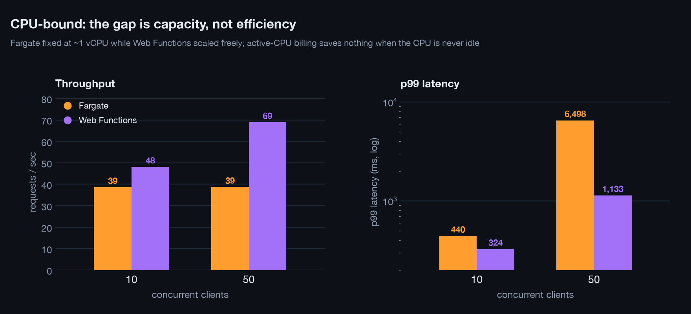
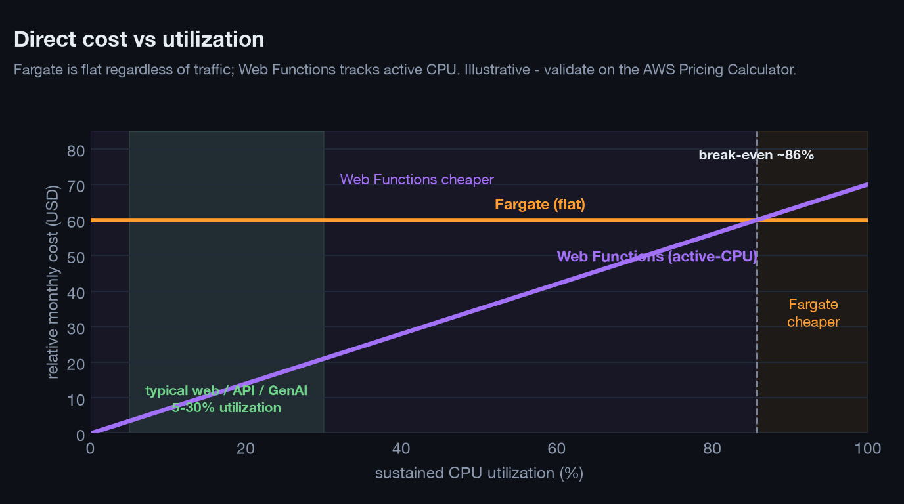
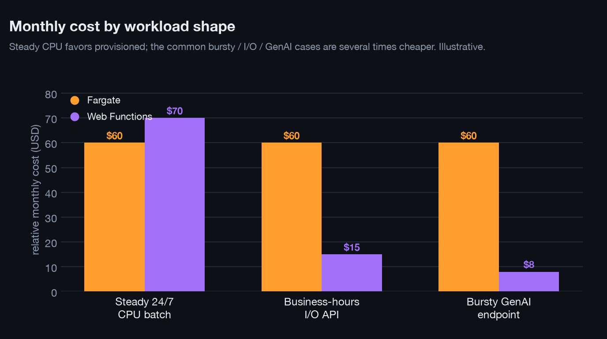
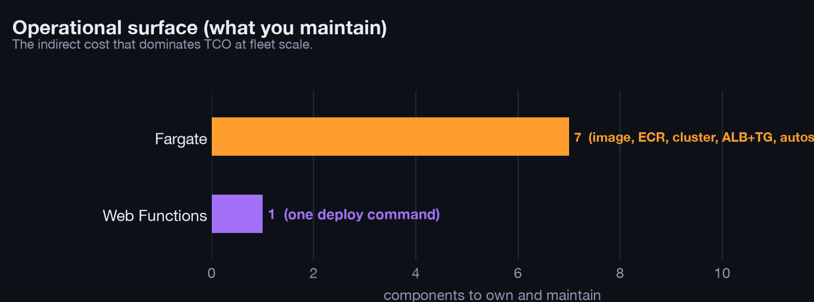

# Validating Enterprise Workloads on AWS Lambda Web Functions

**A migration-decision study, with Dynatrace as the measurement layer**

Status: Draft v2. Audience: enterprise platform engineering, site reliability, and the AWS and Dynatrace field teams.

## Abstract

AWS Lambda Web Functions, released in October 2026, allow a standard port-listening Node.js HTTP server to run on Lambda with per-request concurrency and active-CPU billing. This study evaluates whether an enterprise HTTP service can move from AWS Fargate to Lambda Web Functions without loss of performance. The same Node.js service was deployed to both platforms, instrumented with OpenTelemetry, and measured in Dynatrace under four load profiles. The results show equivalent per-request latency through the 99th percentile, comparable or higher throughput without capacity planning, a measurable cold-start cost confined to the extreme tail, and a clear advantage for input/output-bound and generative-AI workloads. The study also defines a repeatable validation procedure and documents the conditions under which the platform is not appropriate.

## Recommendation

For services that are stateless, input/output-bound, bursty, or backed by a generative-AI model, and that are written in Node.js, we recommend piloting AWS Lambda Web Functions using the validation procedure defined in Section 2, with Dynatrace used to confirm performance parity and to govern the cutover. Services that are CPU-bound at sustained high utilization, that hold state or long-lived connections, or that are written in runtimes other than Node.js should remain on container platforms at this time. The recommended next action is to select one qualifying production service, execute the four-profile procedure for one week, and review the Dynatrace comparison together with the metered cost before any migration decision.

## 1. Background and problem

Enterprises operate large numbers of small HTTP services on always-on container platforms such as Amazon ECS Fargate. Each service carries a continuous cost and a continuous operational burden: a container image to maintain, a cluster to patch, autoscaling policies to tune, a load balancer to operate, and capacity to plan. These costs are incurred continuously, independent of request volume. For services whose requests are bursty, or that spend most of their duration waiting on a database or a model, provisioned capacity is substantially underused.

Lambda Web Functions change the billing and operational model: a service is deployed with a single command, each execution environment serves many concurrent requests, scaling is automatic, and billing is based on active CPU time rather than wall-clock duration. The relevant question for an enterprise is not whether the price is lower in the abstract, but whether a given workload performs equivalently under load, and how that equivalence can be demonstrated before migration. This study answers both questions with measured data.

## 2. Method

A single Node.js service was deployed, without code changes, to two targets: an ECS Fargate service (two tasks, 0.5 vCPU each, behind an Application Load Balancer) and a Lambda Web Function. The only platform-specific difference is the source of the listening port. The service exposes an input/output-bound endpoint, a CPU-bound endpoint, and a generative-AI endpoint that summarizes full-length documents (500,000 to 900,000 words) through Amazon Bedrock (Claude Sonnet) using a map-reduce strategy with approximately eleven concurrent model calls per request.

Both deployments were instrumented with the OpenTelemetry SDK and exported traces and metrics to Dynatrace. Every span and metric carries a `deployment.platform` attribute so that the two platforms can be compared on a single dashboard. Four load profiles were applied identically to both platforms: steady load, bursty load following idle periods, CPU-bound concurrency, and the generative-AI workload. All figures below are measured values from these runs.

## 3. Results

### 3.1 Per-request latency and the tail

Under steady load the two platforms are statistically indistinguishable through the 99th percentile. The difference appears only beyond the 99th percentile, where cold starts on the serverless platform raise the extreme tail (Figure 1). For service-level objectives defined at the 95th or 99th percentile, the platforms are equivalent. For objectives defined at the 99.9th percentile, or for services with large initialization cost, the tail is the governing consideration.

### 3.2 Throughput at equal provisioning

At steady load the Lambda Web Function sustained higher throughput than the sized Fargate service while requiring no capacity configuration (Figure 3).

### 3.3 CPU-bound behavior

The CPU-bound profile is the least favorable case for migration, and the measured difference must be read with care. At low concurrency the two platforms perform comparably, because each executes the computation on a single Node.js thread per environment or task. At high concurrency the Fargate service, which was provisioned at approximately one vCPU in total, queues requests and its tail latency rises steeply, whereas the Lambda Web Function adds environments and sustains a bounded tail (Figure 2). This difference reflects the amount of capacity made available, not a difference in efficiency per unit of compute. A Fargate service configured with autoscaling and additional tasks would close the gap.

Two conclusions follow that are specific to CPU-bound work. First, active-CPU billing produces little or no saving when the processor is continuously busy, so the principal economic reason to adopt the platform does not apply to this class of workload. Second, because each environment runs a single thread, allowing many concurrent CPU-bound requests to share one environment serializes them and degrades tail latency, so the maximum concurrency per environment must be reduced for such endpoints. CPU-bound services at sustained utilization should therefore remain on provisioned, autoscaled capacity.

### 3.4 Generative-AI workload

The document-summarization endpoint issues many concurrent model calls and then streams a combined result. Each request spends most of its wall-clock duration waiting on the model. Under active-CPU billing this waiting time incurs negligible compute cost, and the long-lived streaming response is served directly. Per-call latency was equivalent on both platforms because both call the same model. The economic and architectural advantage lies in the billing model and in native support for streaming, not in model performance.

## 4. Cost analysis and economic conclusions

The cost difference is structural rather than promotional. Fargate bills for provisioned vCPU-hours and memory gigabyte-hours, together with the load balancer, continuously and independently of traffic. For the small two-task baseline used here the cost is on the order of 60 US dollars per month before any request is served (illustrative, us-east-1; confirm with the AWS Pricing Calculator). Lambda Web Functions bill for active CPU time, for memory over the lifetime of each execution environment, and per request, so cost scales with actual work and approaches zero during idle periods.

Figure 4 shows the consequence. Fargate cost is flat with respect to utilization, while Web Functions cost rises with the fraction of time the service actually consumes CPU. The two cross only near sustained high utilization. Web, API, and generative-AI services sit well below that break-even because they spend most of each request waiting on input/output or on a model, and are idle outside peak hours, so Web Functions is less expensive for them, often by a large factor.

Figure 5 applies this to three representative workloads. A service pinned at high CPU around the clock slightly favors provisioned capacity. The common cases, a business-hours input/output-bound API and a bursty generative-AI endpoint, are several times cheaper on Web Functions because idle time and waiting time are not billed.

The second economic lever is operational cost, which does not appear on the AWS invoice but dominates total cost of ownership. Operating the service on Fargate requires owning a container image, a registry, a cluster, a load balancer and target group, an autoscaling policy, task definitions, and base-image patching. The Web Function requires one deploy command (Figure 6). Across a fleet of hundreds of small services, the reduction in engineering time and in the patch and attack surface is material.

Economic conclusion. For the recommended workload class the two levers compound: Web Functions lowers the direct bill, because cost tracks usage rather than provisioned peak, and lowers the indirect cost, because there is almost nothing to operate. The recommendation to migrate stateless, input/output-bound, bursty, and generative-AI Node services is therefore supported on cost as well as on performance, with the single documented exception of workloads that sustain high CPU utilization continuously, where provisioned capacity remains cheaper. A precise figure for a specific service should still be produced by metering its active CPU milliseconds, memory gigabyte-seconds, and request count during the validation run and pricing both platforms against current AWS rates. A generic estimate should not be substituted for this measurement.

## 5. Limitations and exclusions

The following conditions define where the platform is not currently appropriate, and are stated so that the recommendation can be applied correctly.

1. Runtime and region. At release the platform supports Node.js 24 on the Arm64 architecture in five regions. Services written in Java, .NET, or Python cannot be migrated at this time, which excludes a substantial portion of a typical enterprise estate.
2. State and connections. Services that hold session state, in-memory caches, or long-lived background work do not fit a request-and-response model with ephemeral environments.
3. Sustained CPU utilization. Services that run continuously at high CPU utilization are frequently less expensive on provisioned capacity.
4. Downstream connection limits. Because the platform can scale to many environments, each with its own connection pool, services that depend on a connection-limited database require a connection proxy or a protocol-native data store. Dynatrace dependency metrics identify this condition before it affects availability.
5. Network exposure. Endpoints are reachable publicly by default. Production services should be placed behind Amazon CloudFront with origin access control, or should require authenticated access, and secrets should be stored in AWS Secrets Manager rather than in environment variables.

## 6. Role of Dynatrace in the migration decision

The migration decision depends on tail latency, concurrency behavior, and downstream effects, which are not visible in averages. Dynatrace serves as the measurement layer in three respects. First, it renders both platforms on one dashboard partitioned by platform, so that equivalence is demonstrated from data rather than asserted. Second, it reports the 99.9th percentile and maximum, which expose the cold-start cost that lower percentiles conceal. Third, it governs the cutover: Lambda Web Functions support weighted revisions, and Dynatrace compares revisions so that a regression is identified on a small fraction of traffic before full deployment. In-process OpenTelemetry instrumentation is appropriate for ephemeral environments, for which host-based agents are not designed.

## 7. Conclusion

For stateless, input/output-bound, bursty, or generative-AI Node.js services, AWS Lambda Web Functions deliver performance equivalent to a provisioned container service through the 99th percentile, with higher throughput at equal provisioning and a cold-start cost confined to the extreme tail. They also lower total cost of ownership for these workloads on two independent levers: a direct bill that scales with actual work rather than provisioned peak, and a near-elimination of the operational surface that must be maintained. The appropriate course of action is a measured, per-workload validation using the procedure in Section 2, with Dynatrace confirming parity and governing the cutover, rather than a general migration.

## Appendix

The reproducible assets, namely the shared service, the Fargate baseline, the Lambda Web Function deployment, and the Dynatrace comparison dashboard, are contained in this repository and in the hgd83841 Dynatrace tenant. Measurements were taken in AWS account 347830095179, region us-east-1. The figures illustrate method and magnitude and do not constitute a pricing quotation.
